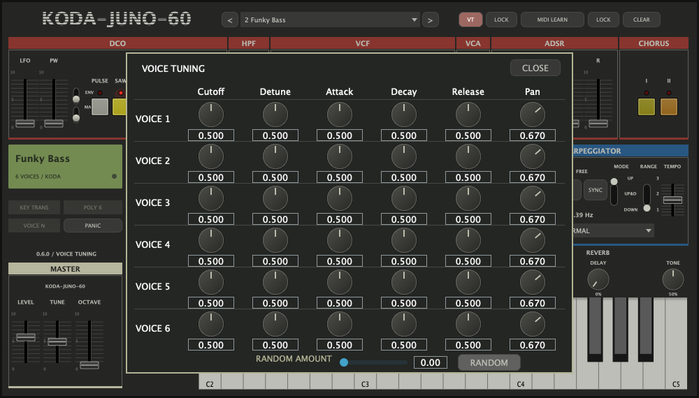

> Atualização 0.6.1: CLEAR passou a restaurar o som do preset, apagando também os mapeamentos MIDI do preset. Veja [correções atuais](preset-midi-061.md). As referências abaixo à exclusão de mapas descrevem a versão 0.6.0.

# Barra VT e MIDI — KODA-JUNO-60 0.6.0

Os cinco controles da barra superior estão funcionais: VT, LOCK de VT, MIDI LEARN, LOCK de MIDI e CLEAR. AU e VST3 instalados para Apple Silicon; standalone disponível em `dist/toolbar-0.6.0/`. A versão anterior está preservada em `/Users/koda/Documents/tal-un-no-60-clone/dist/installed-before-toolbar-20261023-133209`. O AU instalado é byte idêntico ao AU submetido aos testes de áudio.

## Como usar

**VT** abre um painel próprio de Voice Tuning. Cada uma das seis vozes tem Cutoff, Detune, Attack, Decay, Release e Pan: 36 controles. O valor **0.500 é neutro**; um duplo clique retorna o knob ao neutro. RANDOM varia os cinco primeiros controles com a intensidade escolhida e preserva Pan. Intensidade zero retorna esses cinco controles ao neutro. CLOSE ou outro clique em VT fecha o painel. O teclado e a tela principal continuam sendo seus componentes originais.

O **primeiro LOCK**, ao lado de VT, conserva os 36 ajustes ao trocar presets. Ele não impede editar os knobs ou executar RANDOM.

Para usar **MIDI LEARN**:

1. Ative MIDI LEARN.
2. Mexa no controle do KODA que deseja comandar.
3. Mova o knob/fader MIDI físico ou envie um CC da DAW.
4. Repita para outros controles e desligue MIDI LEARN ao terminar.

A barra mostra o nome do controle selecionado. Também é possível selecionar um controle antes de ativar LEARN. O parâmetro mais recentemente alterado é o destino. Uma atribuição não desliga automaticamente o aprendizado. Funciona com os controles principais, arpejador, efeitos, Portamento e os knobs VT, inclusive seletores discretos.

O **segundo LOCK**, depois de MIDI LEARN, conserva os mapeamentos ao trocar presets. Ele não bloqueia novas atribuições nem o movimento de um controlador já aprendido. **CLEAR** apaga os 128 mapeamentos do mapa ativo, mesmo com LOCK ligado, sem alterar o timbre. Os mapas são próprios de cada programa; com LOCK desligado, outro preset pode carregar seu próprio mapa, inclusive mapeamentos originais de fábrica.

Cada CC tem um destino; atribuir o mesmo CC a outro parâmetro substitui o destino anterior. CCs diferentes podem controlar o mesmo parâmetro. O mapa independe do canal MIDI. Sustain e mensagens de modo de canal continuam exercendo sua função musical mesmo quando seu CC recebe uma atribuição.

## Persistência e compatibilidade

A ordem e os IDs anteriores foram preservados. São **113 parâmetros**: os 76 anteriores, 36 novos VT e o LOCK de VT. Os IDs VT seguem `vt1Cutoff` até `vt6Pan`; `voiceTuningLock` é global. O ID antigo `p37`, anteriormente um alias inativo de Global MIDI Learn, agora se chama MIDI Mapping Lock; `p46` continua MIDI learn. Seus IDs não mudaram.

Os ajustes VT e os mapas MIDI são salvos por programa e na sessão. Os locks são globais da instância e também são restaurados pela sessão completa. Uma restauração completa prevalece sobre os locks atuais. MIDI LEARN é transitório e volta desligado ao restaurar uma sessão. Sessões antigas sem VT recebem valores neutros; sem tabelas MIDI novas, usam seus mapas de fábrica, sem herdar mapas da sessão anterior.

O novo modelo salva mapas com IDs de parâmetro estáveis. O carregador aceita os números de CC serializados como atributos XML, rejeita IDs desconhecidos e números fora de 0–127, e trata um mapa explicitamente vazio como vazio. Campos omitidos não conservam mapeamentos ambientes. O processamento usa uma tabela fixa e lookup direto por CC; não resolve strings nem aloca tabelas no callback.

Os controles que gerenciam aprendizado/locks não são destinos de MIDI learn no KODA, evitando autorreferência. Isso é uma escolha explícita de implementação, não uma equivalência completa com todos os destinos admitidos pelo TAL. CLEAR e RANDOM são comandos do editor, não parâmetros adicionais de automação; os resultados de RANDOM nos 36 knobs são automatizáveis e persistidos.

## Evidência REA e DSP

A investigação read-only REA/Ghidra 12.1.4 está em [VT](vt-rea-notes.md) e [MIDI](midi-rea-notes.md). A sessão nativa foi exportada e encerrada. O TAL instalado não foi alterado.

As curvas recuperadas de VT são cúbicas: o offset de Cutoff/Detune é `0.5*(2*x-1)^3`, e os fatores de duração A/D/R são `1+0.5*(2*x-1)^3`, de 0,5 a 1,5. Detune cobre aproximadamente ±50 cents. O panorama usa `L=(1-x*x)*4/3` e `R=(1-(1-x)^2)*4/3`. Os ajustes são por voz, antes da soma comum/chorus/delay/reverb, respeitando o caminho de filtro usado.

A comparação expôs um defeito anterior no filtro compartilhado Save CPU: o canal direito recebia um cutoff já normalizado e o normalizava de novo. A correção calcula o cutoff original uma vez e entrega o mesmo valor aos dois filtros. Não foi aplicada compensação arbitrária de ganho. A regressão de energia espelhada passa em quatro taxas e três cutoffs; restaurar o código antigo faz essa regressão falhar. Em configurações estéreo que usavam esse caminho, a correção pode alterar o resultado anterior, pois remove a assimetria.

Também foram corrigidos dois problemas no intervalo entre MIDI Program Change e atualização visual: salvar nesse intervalo podia combinar programa antigo e mapa novo; selecionar manualmente outro preset podia ser sobrescrito por uma seleção pendente. O programa efetivo é publicado imediatamente, a serialização usa os valores do programa ouvido e uma escolha manual cancela a seleção obsoleta. Há regressões determinísticas sem esperar pelo message loop, incluindo Program Change e CC no mesmo bloco.

## Validação

**13/13 testes CTest passaram**, incluindo os onze anteriores e os novos testes de VT e da barra. A cobertura inclui todas as 36 ligações VT, abrir/fechar painel, RANDOM com intensidade zero/máxima e Pan preservado, CCs em vários canais, reatribuição, parâmetros estendidos/discretos, sustain/CC, alteração do áudio no offset do evento, mapas por preset, independência dos locks, CLEAR, estado completo/legado/inválido e os casos de Program Change descritos acima.

O DSP VT passou com AddressSanitizer/UndefinedBehaviorSanitizer em 8/44,1/48/96 kHz. Um render neutro controlado de seis notas foi byte idêntico ao DSP anterior; isso não estabelece igualdade em todos os patches, especialmente no filtro compartilhado corrigido.

Foram feitos **35 renders AU reais e 27 verificações de áudio**, todos aprovados, em 48 kHz: 30 renders TAL/KODA para VT e cinco para regressão do filtro compartilhado. Todos os 35 hashes foram conferidos. O detune relativo medido foi TAL −50,017/+49,958 cents e KODA aproximadamente −49,999/+49,999. Para Pan=0,25, o ganho relativo ao próprio neutro foi TAL L1,25/R0,583333 e KODA L1,250000/R0,583333. A proporção VT de duração de A/D/R acompanha aproximadamente 3:1 nos dois extremos.

**As durações absolutas do ADSR não são iguais ao TAL.** Por exemplo, no teste de release a −20 dB o TAL mediu aproximadamente 382/1.143 ms e o KODA 103/310 ms. O trabalho implementa os modificadores VT sobre o motor existente; não substitui todo o envelope. Fases, sementes de RANDOM e timbre também não são idênticos. Os limites, parâmetros exatos, métricas e áudios estão em [evidências VT reais](../evidence/toolbar-vt/runtime/README.md).

Sete testes adicionais no AU TAL confirmaram mapeamento independente de canal, valor `CC/127`, aceitação de CC64/123 e substituição do destino de um CC. Os gestos de aprender, os locks e as sessões foram exercitados no KODA via editor/processador e MIDI sintético. Não foi operado um controlador físico nem uma DAW gráfica nesta rodada. A comparação VT usa uma nota e uma taxa com as seis células configuradas igualmente; testes DSP separados cobrem vozes individuais e outras taxas.

AU, VST3 e standalone foram compilados e assinados ad hoc. A validação Apple `auval -v aumu TuCl InAu` do **AU instalado** passou. O VST3 foi compilado/assinado, mas não reproduzido dentro de uma DAW gráfica. A suíte final levou cerca de 7,91 segundos; CPU, pico de memória e custo de tokens da investigação não foram medidos.

## Arquivos

- Verificação consolidada e instalação: `evidence/toolbar/implementation/verification.json` e `installation.json`.
- Testes/build/auval e captura: `evidence/toolbar/implementation/`.
- REA VT completo: `evidence/toolbar-vt/rea-20261023/evidence-bundle.json` e seu índice.
- Áudio comparado e hashes: `evidence/toolbar-vt/runtime/summary.json` e relatórios relacionados.
- MIDI TAL: `evidence/toolbar-midi/runtime.json`.
- Implementação: `Source/VoiceTuningParameters.h`, `VoiceTuningPanel.h`, `MidiMappings.h`, processador/editor e `DSP/SynthDSP.*`.

Reinicie a DAW para carregar 0.6.0.
