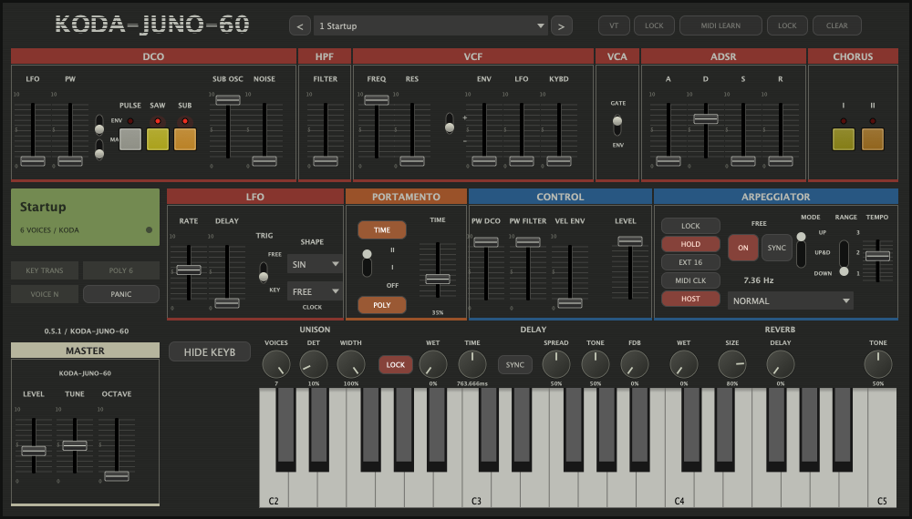

# Correção visual 0.5.1 — 23/10/2026

Nota: esta versão visual foi sucedida pela [implementação funcional 0.6.0](barra-vt-midi-implementacao.md).

Escopo escolhido pelo usuário: corrigir o visual agora, sem implementar VT ou MIDI learn nesta rodada.

O MORE e o painel de parâmetros internos foram removidos, incluindo a criação dos sliders ocultos e o caminho que substituía o teclado. Os parâmetros anteriores continuam existentes para compatibilidade com sessões e automação. Os dois botões quadrados antigos de MIDI learn/global learn saíram do cabeçalho. A barra superior mostra VT, LOCK, MIDI LEARN, LOCK e CLEAR em botões textuais. Esses cinco controles ficam desativados e seus tooltips informam que as funções não foram implementadas. Não foram ligados artificialmente ao FX LOCK, ao ARP LOCK ou a parâmetros sem relação.

PANIC continua funcional, agora abaixo dos presets, na área esquerda como na imagem de referência. HIDE KEYB apenas oculta/mostra o teclado. O indicador de sustain fica no visor esquerdo. Nenhum arquivo do DSP foi alterado.

Os onze testes CTest passaram, incluindo attachments, presets, estado antigo, efeitos, arpejador, Portamento e PANIC. O editor real foi renderizado e inspecionado. A geração das capturas nos testes de FX e Portamento foi corrigida para truncar o arquivo antes de escrever: as capturas repetidas antes concatenavam PNGs e podiam mostrar uma imagem antiga. A captura final contém exatamente um PNG.

AU, VST3 e standalone foram compilados e assinados ad hoc. AU e VST3 foram instalados com backup da versão anterior; o AU instalado passou no auval da Apple. Não foi controlada uma DAW gráfica nesta rodada. Reinicie a DAW para carregar a nova versão.

Evidências: `evidence/interface-0.5.1/installation.json`, `testes.log`, `auval.log` e logs de build. Pacote: `dist/interface-0.5.1/`.

Referência externa consultada: [manual oficial TAL-U-NO-LX](https://tal-software.com/downloads/docs/TAL-U-NO-LX-UserManual.pdf), seção MIDI LEARN; as posições visuais seguem a imagem fornecida pelo usuário. A consulta não estabelece equivalência funcional do KODA para funções ainda ausentes.
