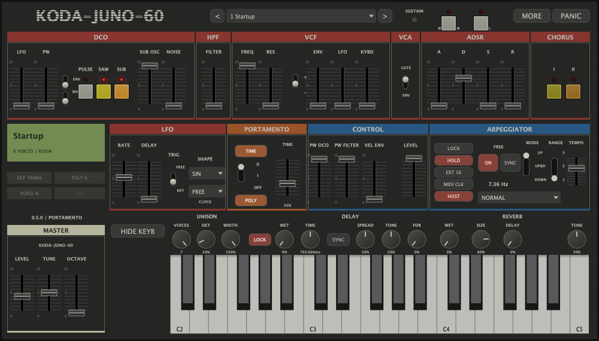

# Portamento implementado — KODA-JUNO-60 0.5.0

Implementado e instalado para Apple Silicon: AU e VST3 nas pastas de usuário, com standalone no pacote `dist/portamento-0.5.0/`. O binário AU instalado tem o mesmo SHA-256 do binário submetido à comparação de áudio. A versão anterior está preservada em `/Users/koda/Documents/tal-un-no-60-clone/dist/installed-before-portamento-20261019-013554`.

## Comportamento e painel

Os quatro controles da seção PORTAMENTO estão ligados ao APVTS e ao áudio: seletor OFF/I/II, slider TIME, botão TIME e POLY. São quatro parâmetros acrescentados ao final da ordem anterior, mantendo os 72 IDs anteriores: **76 parâmetros**, 120 programas. Os IDs novos são `portamentoMode` (0–2), `portamentoAmount` (0–1), `portamentoTime` e `portamentoPoly` (botões). O AU expõe esses controles na escala normalizada do host; os valores de modo do APVTS/editor são 0/1/2.

- OFF preserva a afinação direta do motor anterior.
- I desliza em legato; uma frase nova começa na altura tocada.
- II conserva a memória de altura por voz, inclusive após silêncio; uma voz recém-inicializada começa em 42, como no TAL.
- POLY desligado usa uma voz e prioridade da última tecla; soltar a tecla superior retorna suavemente à última nota ainda pressionada.
- POLY ligado mantém seis vozes independentes e reutiliza a memória da voz escolhida pelo alocador.
- TIME desligado define velocidade constante em semitons; TIME ligado ajusta o passo para duração aproximadamente constante entre intervalos diferentes.

A curva de sexta potência e o passo float32 seguem a [engenharia reversa REA](portamento-rea.md). O glide entra no pitch antes dos osciladores e dos offsets de Unison. O passo é calculado no início da nota; mudar o slider durante a nota altera o próximo início, conforme o caminho recuperado. Trocas que mudam a alocação mono/poly encerram o roteamento anterior para evitar notas presas. Os envelopes preservam legato mono e recebem retrigger quando necessário, incluindo o caminho de arpejador.

Os valores são salvos por programa e na sessão. FX LOCK protege apenas Delay/Reverb e não bloqueia Portamento; ARP LOCK também não o bloqueia. Sessões antigas recebem Portamento OFF e demais valores zero. PANIC limpa a pilha de teclas, sustain e memória de altura. O processamento usa arrays fixos, sem alocação no note-on ou por amostra.



## Verificação

**11/11 testes CTest passaram.** O novo teste DSP verifica OFF/I/II, TIME, subida/descida, mono/retorno/sustain, reutilização de uma voz liberada e de seis vozes simultâneas, reset e saída finita a 44,1/48/96 kHz. O teste de processador verifica os quatro attachments do painel nos dois sentidos, presets, separação do FX LOCK, estado completo e legado, integração com Unison/arpejador/sustain e PANIC. Os testes anteriores de arpejador, MIDI, efeitos e banco continuam passando.

AddressSanitizer e UndefinedBehaviorSanitizer passaram no teste de Portamento/DSP. O editor foi renderizado e inspecionado. AU, VST3 e standalone foram compilados, assinados ad hoc e verificados. O `auval -v aumu TuCl InAu` da Apple aprovou o **AU instalado**. Nenhuma DAW gráfica foi controlada nesta rodada; a reprodução VST3 dentro de uma DAW não foi verificada.

## Comparação real com TAL

Foram renderizados **58 cenários em cada instrumento e em cada taxa** (44,1 e 48 kHz): **232 renders** na matriz final. Cada cenário registra binário/hash, parâmetros, eventos MIDI agendados, áudio float32 estéreo e trajetória de altura estimada. As matrizes cobrem OFF/I/II × POLY × sobreposição/gap, cinco intensidades × TIME ligado/desligado × intervalos de ±5/±12 semitons, sequências de reutilização de voz e retorno mono.

A comparação passou em **58/58 cenários nas duas taxas**. Os critérios definidos foram diferença de altura no percentil 95 até 10 cents, máximo de 20 cents, e diferença de chegada à nota até 10 ms. São tolerâncias da trajetória de glide, não equivalência de timbre. A análise usa autocorrelação com janela de 1536 amostras e passo de 220 amostras. Acordes simultâneos são excluídos das janelas comparadas; POLY é comparado quando a voz relevante já está isolada. A chegada única não se aplica às sequências com várias notas e é registrada como desconhecida em vez de um número fictício.

| Taxa | Maior diferença de chegada | Maior percentil 95 entre cenários | Maior diferença pontual |
|---|---:|---:|---:|
| 44,1 kHz | 4,989 ms | 7,40 cents | 17,38 cents |
| 48 kHz | 4,584 ms | 5,54 cents | 17,39 cents |

Exemplo com slider em .5, subida de 12 semitons: a chegada medida foi **484,082 ms** nos dois instrumentos em 44,1 kHz, com TIME desligado; com TIME ligado, **793,379 ms** nos dois. Para cinco semitons, **199,728 ms** e **788,390 ms**, respectivamente, também nos dois. Esses resultados incluem o método de estimativa de altura; não são relógios internos exatos.

A comparação identificou e levou à correção de um erro real de alocação: vozes ainda não usadas com nota padrão 64 estavam sendo escolhidas antes da voz liberada, perdendo a memória correta no modo II. O alocador agora distingue correspondência de nota ativa de voz ociosa, com regressão específica e nova matriz completa após a correção.

[A/B de áudio — primeiro TAL, depois KODA](../evidence/portamento/implementation/portamento-tal-depois-koda.wav): duas notas, modo I, intensidade .5, botão TIME ligado. São 2,4 segundos de TAL, 0,3 segundo de silêncio e 2,4 segundos de KODA. Foi aplicado um único ganho comum aos dois; a diferença de ganho/timbre seco dos motores permanece.

Evidência final: `evidence/portamento/implementation/comparison-44100-final.json`, `comparison-48000-final.json`, quatro relatórios `evidence/portamento/{tal,koda}-{44100,48000}-final/results.json`, logs de build, sanitizers e auval. Matrizes anteriores são intermediárias. Os quatro relatórios finais levaram 19,46/17,95/20,94/19,44 segundos, respectivamente, executados em paralelo; esses tempos não representam um benchmark isolado. CPU, pico de memória e custo de tokens não foram medidos.

O Portamento acompanha de perto o comportamento medido do TAL. Isso não estabelece áudio idêntico entre os sintetizadores: filtros, envelopes, fases, Reverb e outras partes mantêm diferenças já documentadas. Sustain/arpejador/Unison receberam testes de integração e estabilidade no KODA; não foi estabelecida equivalência com TAL para todas as suas combinações, MPE/microafinação ou automação durante a nota.

## Reprodução dos testes

```sh
sh tools/build-au.sh
clang++ tools/au-portamento-probe.cpp -std=c++17 -framework AudioToolbox -framework AudioUnit -framework CoreFoundation -o /tmp/koda-portamento-probe
KODA_PORT_ENGINE=tal KODA_PORT_SR=44100 KODA_PORT_OUTPUT=evidence/portamento/tal-recheck /CAMINHO/PYTHON_COM_NUMPY tools/analyze-portamento.py
KODA_PORT_ENGINE=koda KODA_PORT_SR=44100 KODA_PORT_OUTPUT=evidence/portamento/koda-recheck /CAMINHO/PYTHON_COM_NUMPY tools/analyze-portamento.py
/CAMINHO/PYTHON_COM_NUMPY tools/compare-portamento.py --reference evidence/portamento/tal-recheck/results.json --candidate evidence/portamento/koda-recheck/results.json --output evidence/portamento/recheck-comparison.json
```

O Python usado nesta máquina foi `/Users/koda/.cache/codex-runtimes/codex-primary-runtime/dependencies/python/bin/python3`. Nenhuma dependência foi instalada. Reinicie a DAW para carregar 0.5.0.
