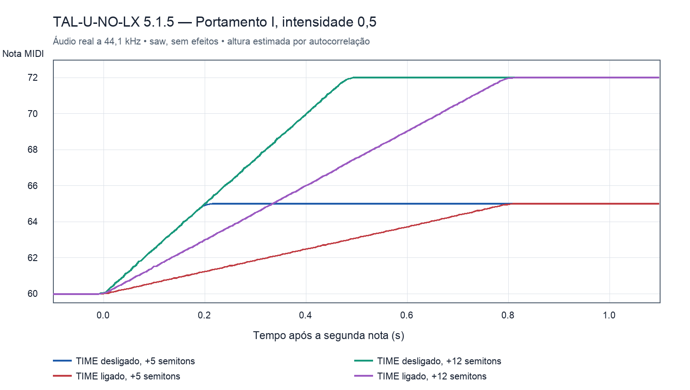

# Portamento do TAL-U-NO-LX — engenharia reversa com REA

Análise de 19/10/2026, limitada à seção PORTAMENTO da imagem: botão TIME, slider TIME, seletor OFF/I/II e POLY. Foi usado o TAL-U-NO-LX-V2 AU 5.1.5 instalado, com REA/Ghidra 12.1.4 e testes reais do AU offline. O KODA não foi alterado nesta investigação. A implementação posterior está em [Portamento 0.5.0](portamento-implementacao.md).

## Resultado para o músico

| Controle | Comportamento confirmado |
|---|---|
| OFF | Muda imediatamente para a altura da nova nota. |
| I | Portamento em legato: desliza ao sobrepor notas; nova frase começa diretamente na nota tocada. |
| II | Mantém a altura anterior da voz e desliza também em notas separadas. |
| POLY desligado | Portamento ativo força uma voz, com prioridade da nota mais recente. Ao soltá-la, volta à última nota ainda pressionada. |
| POLY ligado | Mantém a quantidade configurada de vozes. Cada voz tem sua própria memória de altura e glide. |
| Slider TIME | Define uma curva não linear de velocidade/duração; quanto maior, mais lento. |
| Botão TIME desligado | Velocidade constante em semitons por segundo. Intervalos maiores levam mais tempo. |
| Botão TIME ligado | Duração aproximadamente constante independentemente do intervalo inicial. |

O último ponto não significa que o caminho em frequência seja linear: a rampa é linear em altura musical (semitons), produzindo variação exponencial em hertz.

## Parâmetros e armazenamento observados

O AU expõe quatro parâmetros normalizados em 0–1, todos com default 0: `portamento mode` (42), `portamento intensity` (43), `portamento poly` (53) e `portamento time` (56). Esses índices são do TAL, não novos IDs para o KODA. O seletor usa `int(2*x + .5)` → OFF/I/II; os dois botões usam limiar `.5`.

Em `SynthEngine::parameterChanged` (0x53238), o ParamHelper guarda modo em +0x64, intensidade em +0x68, POLY em +0x6c e botão TIME em +0xd1. Com modo desligado o gerenciador mantém a polifonia configurada; com modo ativo e POLY desligado, usa uma voz. Evidence: `008-parameters.json`, com IDs no [índice](../evidence/portamento/rea-20261019/INDEX.md).

## Fórmula recuperada

`SynthVoice::setNoteOn` (0x46b88) calcula o passo no início da nota. Seja `p` o slider normalizado, `Fs` a taxa de amostragem, `P` a altura atual da voz e `T` a altura alvo, já incluindo o ajuste de afinação aplicável nessa etapa:

```text
R = 10000 * (0.11 - 0.10*p)^6 + 0.0001
fator = TIME ? abs(P - T) * 0.05 : 1
passo = fator * R / (Fs / 44100)
```

`SynthVoice::setSampleRate` (0x4a418) confirma que o divisor guardado é `Fs * 2.2675737e-05`, aproximadamente `Fs/44100`. O passo é armazenado por voz. A trajetória em `SynthVoice::process` (0x4492c) avança uma vez por amostra:

```text
se modo == OFF: P = T
senão se P < T: P = min(P + passo, T)
senão se P > T: P = max(P - passo, T)
```

O clamp impede ultrapassar o alvo. O passo é calculado em note-on, não continuamente a cada amostra a partir do slider. A afinação resultante entra no VCO antes dos offsets de Unison. O algoritmo não é um filtro exponencial que se aproxima indefinidamente da nota.

As durações ideais, derivadas em aritmética real, são:

```text
TIME desligado: segundos = abs(T-P_inicial) / (44100*R)
TIME ligado:    segundos = 20 / (44100*R), para intervalo não nulo
```

| Slider | TIME off: 5 semitons | TIME off: 12 semitons | TIME on: qualquer intervalo não nulo |
|---|---:|---:|---:|
| 0 | 6,36 ms | 15,27 ms | 25,46 ms |
| .25 | 29,29 ms | 70,29 ms | 117,14 ms |
| .50 | 200,12 ms | 480,28 ms | 800,47 ms |
| .75 | 957,73 ms | 2.298,55 ms | 3.830,92 ms |
| 1 | 1.133,67 ms | 2.720,82 ms | 4.534,69 ms |

Esses são valores matemáticos derivados do código, não medições exatas. O TAL acumula o pitch em float32: quantização do passo, altura inicial, estimador e tolerância de chegada produzem diferenças perceptíveis, principalmente no extremo lento. Slider zero ainda produz um glide curto quando o modo está ativo.

## Vozes, primeira nota e envelopes

O construtor `SynthVoice` (0x51814) aloca um estado exclusivo de 20 bytes para o glide, apontado por `voice+0x30`. Seus campos são: escala Fs/44100 em +0, altura atual em +4, último valor da intensidade em +8, passo em +12 e fator TIME em +16. A altura inicial é exatamente **42.0**. Isso explica a primeira nota do modo II poder deslizar de uma altura inicial mesmo sem uma nota anterior tocada; não é uma variável global com a última tecla.

Modo I reinicializa essa altura para o novo alvo quando a voz começa uma frase sem gates ativos, e também trata o estado de inatividade do envelope. Modo II preserva a memória da voz ociosa. Com POLY ligado, duas vozes recém-usadas podem partir da mesma altura inicial 42, em vez de a segunda começar na tecla anterior. O alocador pode reutilizar uma voz já liberada; uma sequência de notas separadas, sozinha, não prova memória global.

O note-on também trata os envelopes: em frase nova reinicia o envelope relevante e atualiza a velocidade; no legato mono pode conservar o envelope. O flag de arpejador ativo força o caminho de retrigger identificado em +0x6d. Isso é observação estática; esta investigação não mediu todas as combinações arpejador/sustain/MPE/microafinação.

`VoiceManager::setNoteOn` (0x4644c) escolhe a voz e distingue o caminho mono do polifônico. `setNoteOff` (0x52bb0) retira a nota da pilha mono e chama novamente o note-on da voz com a primeira nota restante; a lista insere a mais recente na frente. O pitch pertence à voz, enquanto a pilha de teclas pertence ao gerenciador.

## Teste do áudio de referência

O harness `tools/au-portamento-probe.cpp` instancia exclusivamente o AU selecionado, agenda eventos MIDI e salva float32 estéreo sem dispositivo de áudio nem interface gráfica. `tools/analyze-portamento.py` registra parâmetros, eventos, taxa, hashes e trajetórias estimadas. A forma de onda usada é saw, com envelope sustentado e efeitos desligados. Evidência em `evidence/portamento/runtime/`.

Foram concluídos **68 renders reais**: 58 a 44,1 kHz e 10 a 48 kHz. A [cobertura](../evidence/portamento/runtime/coverage.json) registra os cinco relatórios, identidades e limitações. Os renders somaram aproximadamente 21,83 segundos; CPU, pico de memória e tokens não foram medidos.



Em 44,1 kHz, intensidade .5, modo I mono deslizou na sobreposição e começou diretamente no alvo após um gap de 20 ms; modo II deslizou nos dois casos. TIME off mediu aproximadamente 0,20 s para 5 semitons e 0,484 s para 12. TIME on mediu aproximadamente 0,79 s para ambos. Em 48 kHz, a subida de 12 semitons mediu aproximadamente 0,483 s sem TIME e 0,794 s com TIME, coerente com a compensação de taxa do código.

O teste com seis vozes tocando 48/52/55/60/64/67 e depois uma nova nota 72 isolou a reutilização: o glide partiu da voz de altura 48, embora a última nota global fosse 67. Ao soltar 72 no modo mono enquanto 60 continuava pressionada, I e II deslizaram de volta a 60 em aproximadamente meio segundo.

As subidas e descidas seguem rampas aproximadamente lineares em pitch. Estimativas por autocorrelação podem confundir múltiplas notas simultâneas, portanto os números de chegada polifônicos não são tratados como uma voz isolada nem como prova de afinação incorreta. O comportamento de memória por voz está estabelecido pelo código e corroborado por testes com isolamento de vozes.

## Aplicação futura no KODA

A reprodução deve criar estado de portamento em cada voz; coordenar mono/poly com o alocador e a pilha de teclas; separar legato do retrigger de envelopes; preservar os quatro parâmetros em automação/presets/sessão; aplicar o glide no pitch antes dos VCOs, inclusive Unison, e conservar a ordem dos offsets. Usar um simples smoothing global de frequência perderia essas propriedades.

Os controles desenhados no painel atual do KODA são apenas apresentação da seção: esta tarefa investigou o TAL e não os conectou nem alterou o DSP. A implementação deve ser testada com início de frase, sobreposição, retorno ao soltar a última nota, reutilização de vozes, sustain, arpejador, mudanças de modo e taxas de amostragem. Os limites ainda não medidos estão listados acima.

## Proveniência e cobertura

Binário universal instalado SHA-256 `99bcc10a28984d52e46299f8369b7a3cb0648ae99358ec3e8d5628d5f113aba6`; slice ARM64 analisado `f42ba995938a5df3a0beed6d28c214b80207c919f692306650222a32b1ef55e0`. Identidades, pseudocódigo, requisições/respostas e Evidence IDs ficam em `evidence/portamento/rea-20261019/`; bundle completo exportado e sessão encerrada ao final. O código decompilado é uma representação recuperada, não o fonte do fabricante.

Respondidos: mapeamento dos quatro controles; modos I/II; fórmula de velocidade/TIME; compensação de Fs; estado por voz e inicialização; coordenação básica com mono/poly e envelopes. Parcial: alocação/sustain/arpejador em todas as combinações e automação durante uma nota. Não foi estabelecida equivalência auditiva de uma implementação KODA, pois nenhuma implementação foi feita nesta etapa.
