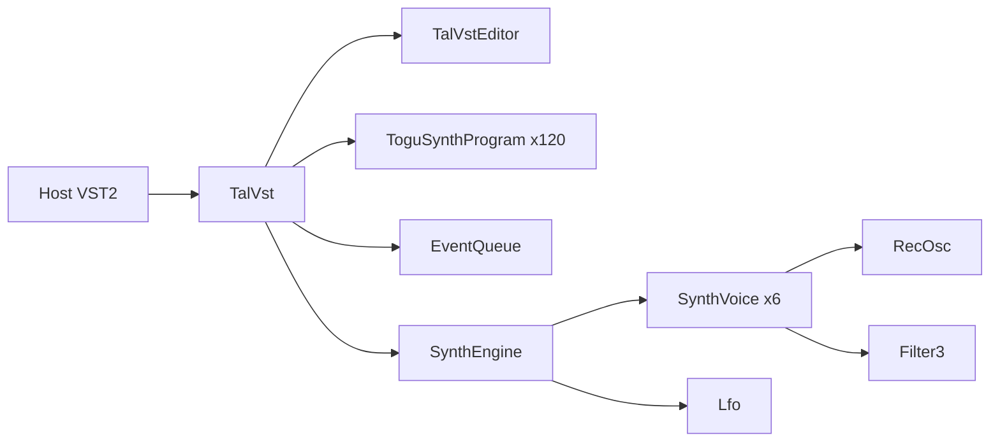

# Banco e classes originais

O binário fornecido contém **120 registros de programa**, não128. Evidência direta:
`TalVst::TalVst` em0x558a passa `numPrograms=0x78`, `numParams=0x2f` ao
construtor AudioEffectX; reserva dois bancos e copia `0x24180` bytes do banco
de fábrica. Cada registro tem `0x4d0` bytes; `0x24180 / 0x4d0 = 120`.
Evidência `ev_a58cbdf4339c78d0ef653a042e10b35ef1e16158872c56dac928e294335502e0`,
[pseudocódigo completo](../evidence/0x558a.json).

O assembly0x5593 chama `get_pc_thunk_bx`; retorno0x5598 torna-se a base EBX.
Em0x57dd o banco é `EBX+0x2e788 = 0x33d20`. A função thunk em0x24adc
confirma `MOV EBX,[ESP]; RET`. Evidências:
`ev_ebd47215691ad8cc5ab825996c7ce285a9a41a004ce777a18d262ee1c97c5de6`
([assembly](../evidence/ctor-assembly.json)) e [thunk](../evidence/pc-thunk.json).
REA mapeia endereço0x33d20 para offset212256/0x33d20 da fatia i386:
`ev_4e20ec53f978a2b099c5524599dbf3d2e8d375b31bb6ac2c9c2d5348d2deaf17`
([mapeamento](../evidence/bank-file-offset.json)). A igualdade endereço/offset é
específica desse mapeamento, não uma regra genérica de Mach-O.

| Offset no registro | Estrutura extraída | Evidência |
| --- | --- | --- |
| 0x00 | área de nome24bytes | cópia em getProgramNameIndexed0x4dc2 e construtor |
| 0x18 | 47 floats little endian | construtor ToguSynthProgram0x4ae0 |
| 0xd4 | 255 inteiros de mapa MIDI | construtor0x4ae0 e uso MIDI0x8970 |
| tamanho0x4d0 | nome+parâmetros+mapa | stride em construtor, getChunk e setChunk |

Os nomes e todos os valores são preservados em
[factory-presets.json](../evidence/factory-presets.json) e
[preset-names.csv](../evidence/preset-names.csv). O payload original está em
[factory-bank.bin](../evidence/factory-bank.bin). O script
[extract_presets.py](../tools/extract_presets.py) verifica SHA256 antes de ler o
banco e reproduz o cabeçalho C++ [FactoryPresets.h](../Source/FactoryPresets.h).
As áreas de nome nos índices40/41 ocupam24bytes sem NUL interno; o parser usa
limite explícito para não ler floats como texto. Não foram inventados os oito
programas adicionais pedidos no contexto.

```cpp
// TalVst constructor0x558a, simplificado do pseudocódigo recuperado
AudioEffectX(audioMaster, 120, 47);
programs = new ToguSynthProgram[120];
chunkCopy = new ToguSynthProgram[120];
memcpy(programs, factoryBankAt0x33d20, 0x24180);
setProgram(0); // Startup, não o default genérico
// getProgramNameIndexed0x4dc2
if (index > 119) return false;
strcpy(destination, programs[index].name);
// getChunk0x5d9a: banco completo ou programa atual
return isPreset ? 0x4d0 : 0x24180;
```

`getChunk`0x5d9a:
`ev_0b25d6798bc23edc20175cec8652e3119e79b3024b4f6f15b7b7398cb0802ad4`.
`setChunk`0x5fd0:
`ev_3dfdecfcedc983105f1ec51e90dde8f9221a506ab3d090c9749a2ad45a5a2443`.
O clone usa parser próprio com validação de tamanho e floats finitos; o original
não valida comprimento no pseudocódigo dessa callback. Importação big endian e
wrappers FXB/FXP permanecem `// TODO verificar`.

## Responsabilidades de classes

| Classe original | Papel observado | Endereços |
| --- | --- | --- |
| TalVst / AudioEffectX | interfaceVST2, parâmetros, eventos MIDI, banco e chunks | 0x558a,0x51ae,0x8970,0x5d9a,0x5fd0 |
| TalVstEditor / AEffGUIEditor | construçãoCFrame e callbacks dos controles | 0x7978,0x6c96 |
| ToguSynthProgram | registro de nome47parâmetros255mapeamentosMIDI | 0x4ae0 |
| SynthEngine | seis vozes, modulação, soma, filtros globais, chorus | 0x327c,0x1f16 |
| SynthVoice | osciladores, envelopes e LPF por voz | 0x255b8,0x258ce |
| RecOsc | oscilador pulse/sub com correção de descontinuidade | 0x24b1c |
| Filter3 | filtro não linear com realimentação | 0x24d3e |
| Lfo | rate, forma de onda e tick | 0x14e8,0x16e8,0x150c |
| EventQueue | fila MIDI com delta em samples | 0x131a,0x1440,0x14b8 |

Não foi estabelecida uma classe separada de preset manager no original;
o banco pertence a TalVst. `PresetManager` no clone é uma divisão de
responsabilidade criada para a reimplementação.


